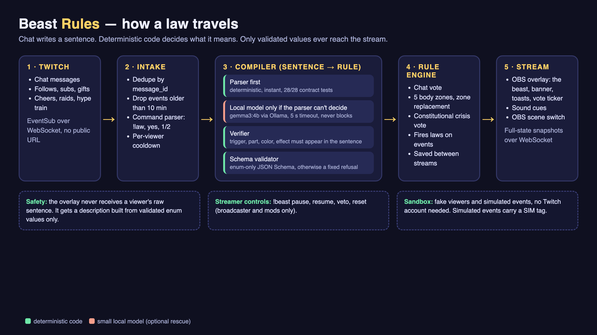
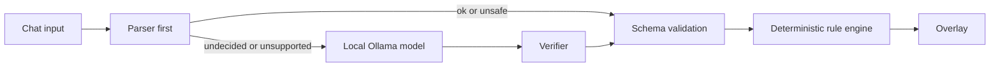

# Beast Rules

Chat writes the laws of the stream, and the laws are the creature. Viewers propose rules, vote on them, and watch the beast evolve.



## Try it in 60 seconds

```sh
npm install && npm run sandbox
```

Or watch the whole story play itself (a law, a crisis, a repeal, a naming vote, the constitution) with no setup:

```sh
npm run demo
```

No credentials are needed. Open [localhost:3000/sandbox.html](http://localhost:3000/sandbox.html); the transparent OBS browser source is [localhost:3000/overlay.html](http://localhost:3000/overlay.html). Ollama is optional.

## Safety gate

Viewer proposals are compiled into closed-schema rules. The original chat sentence is kept for server-side logs and persisted history only; the overlay and sandbox receive a canonical description assembled from validated trigger, action, part, and color enums. Refusal and error messages shown to viewers are fixed text, and displayed usernames are control-character-stripped, capped at 24 characters, and rendered as text.



The model can only emit values from the schema; verified model results pass schema validation before the deterministic engine handles them.

## Example law

Chat sends:

```text
when someone subs grow wings and shake the screen
```

The real TemplateCompiler produces this schema-valid rule:

```json
{
  "status": "ok",
  "trigger": {
    "event_type": "channel.subscribe",
    "threshold": 1
  },
  "action": {
    "type": "screen_shake",
    "intensity": "low"
  },
  "mutation": {
    "part_id": "wings",
    "color": "yellow"
  }
}
```

When the vote passes, the overlay shows the law-passed banner and pulses the wings; a subscription then triggers the screen shake.

## How we measured compile accuracy

| Set | Parser alone | With local-model rescue | Note |
| --- | ---: | ---: | --- |
| Contract (`tests/laws.json`, 28 cases) | 28/28 | n/a | Written alongside the parser, so it is a regression suite, not a test of generalization. |
| Held-out set 1 | 18/30 | 24/30, later 25/30 | Became a development set once its failures were fixed. |
| Held-out set 2, first two runs | 23/30 (76.7%) | 24/30 and 25/30 | Its failures were then fixed, so the parser now scores 28/30 on it. That number is no longer an independent measure. |
| **Held-out set 3 (`tests/heldout3.json`)** | **25/30 (83.3%)** | **26/30 (86.7%)** | 30 new phrasings written after the last parser change, run once, never tuned against. Paths: parser 26, model (verified) 1, parser (model rejected) 3. |

The four misses on set 3 share one weakness: when a sentence names an effect or part the beast does not know ("moonwalk", "jetpack"), or is vague or destructive ("do something cool on subs", "delete the chat history"), the parser can fall back to a harmless default rule instead of refusing. The result is safe, because the closed vocabulary cannot do anything harmful, but it is the wrong feedback for a viewer. It is a known limitation, not fixed here, so the set stays an honest measurement.

Run `npm run eval -- --file tests/heldout3.json --verbose` to reproduce. The model rescue varies between runs, and these small sets measure only their own phrasings, not general language understanding.

<details>
<summary>All 28 contract cases, as the real parser handles them today</summary>

| Sentence | What the compiler produced | Pass |
|---|---|---|
| when someone subs grow wings and shake the screen | subscribe → yellow wings, screen_shake | ✅ |
| every follow gives the beast horns | follow → yellow horns, confetti | ✅ |
| on a raid make the beast roar and grow flames | raid → yellow flames, beast_roar | ✅ |
| when someone cheers bits give it purple lightning | cheer → purple lightning, confetti | ✅ |
| if chat hits 30 messages a minute flash the screen and grow spikes | chat.message ×30 → yellow spikes, screen_flash | ✅ |
| gift subs make the beast grow a golden crown | subscription.gift → yellow crown, confetti | ✅ |
| when a hype train starts throw confetti and grow extra arms | hype_train.begin → yellow extra arms, confetti | ✅ |
| every 5 subs switch to scene 2 and grow armor | subscribe ×5 → yellow armor, obs_scene_2 | ✅ |
| when chat gets loud trigger dare 1 | chat.message → yellow runes, dare_1 | ✅ |
| follows make the beast grow red eyes | follow → red eyes, confetti | ✅ |
| 10 cheers gives it blue tentacles and a screen shake | cheer ×10 → blue tentacles, screen_shake | ✅ |
| raids give the beast a green shell | raid → green shell, confetti | ✅ |
| when someone subs give it a long pink tail | subscribe → pink tail, confetti | ✅ |
| chat spamming 50 messages a minute triggers dare 3 and claws | chat.message ×50 → yellow claws, dare_3 | ✅ |
| subs summon lightning and the beast roars | subscribe → yellow lightning, beast_roar | ✅ |
| new followers make it grow scales and flash orange | follow → orange scales, screen_flash | ✅ |
| when someone donates ten dollars grow wings | refused: unsupported_trigger | ✅ |
| when the streamer dies in the game grow horns | refused: unsupported_trigger | ✅ |
| make the beast dance when someone subs | refused: unsupported_effect | ✅ |
| grow a laser cannon when someone subs | refused: unsupported_part | ✅ |
| switch to scene 7 on a raid | refused: unsupported_effect | ✅ |
| make it cooler | refused: too_vague | ✅ |
| something with the beast | refused: too_vague | ✅ |
| do stuff | refused: too_vague | ✅ |
| ban the loudest chatter whenever chat is busy | refused: unsafe | ✅ |
| when someone subs show the streamer's home address | refused: unsafe | ✅ |
| grow horns and tell chat to harass the mod | refused: unsafe | ✅ |
| timeout everyone who follows | refused: unsafe | ✅ |

</details>

## What works today

- Schema-validated template parsing, with 28/28 contract cases passing; optional local Ollama rescue uses a verifier and falls back safely.
- Persistent proposals, voting, zone replacement, constitutional crisis votes, streamer pause/resume/reset/veto controls, and overlay snapshots.
- Transparent SVG beast overlay with five evolution tiers, all 15 parts, law-passed and crisis-resolution banners, proposer credits, and a live vote ticker.
- Synthesized Web Audio cues (no audio files), plus sandbox crowd simulation with adjustable yes bias and direct buttons for the four overlay effects.
- Twitch EventSub WebSocket integration for chat, follow, subscription, gift, cheer, raid, and hype-train events; chat command translation and fixtures are tested. `/health` reports service state.
- OBS scene actions mapped to server-configured scene names; the adapter is tested with mocks only. Live OBS switching has not been verified.
- **Numbered ballot.** Every `BALLOT_MINUTES` (default 5, `0` turns it off) the overlay offers three suggested laws for `BALLOT_SECONDS` (default 20). Chat types `1`, `2` or `3`; the winner is enacted with no second vote (a tie goes to the lower number, and no votes means no winner). Suggestions are built deterministically from templates, run through the real parser (anything that does not compile is discarded), favour empty body zones and recent event types, and never repeat a part already on the beast. Only canonical descriptions are shown.
- **`!laws` and `!repeal`.** `!laws` shows a six-second panel of the active laws; `!repeal 3` opens a yes/no vote to remove `law-3` (same rules as a proposal: one vote at a time, per-viewer cooldown, blocked while paused, during a crisis or during a ballot). A repealed law moves to history as "repealed" and its zone is free again.
- Malformed requests to the sandbox API get a short JSON error, never a stack trace.
- **Captions without a narrator.** Every new law's banner carries its own caption: article number, the law's title, the vote result ("passed 3-1", "won the ballot 3 of 4 votes", "survived 3-1") and its sponsor. When a law fires, the toast names the sponsor too.
- **The beast wants things.** It shows one visible desire derived from its mood and gaps ("Pebble wants a law about raids") and reacts when chat satisfies it ("Pebble is pleased"). A resolved crisis or repeal draws a crack on the beast with a thud.
- **A cover for the constitution.** `/constitution.html` opens with the beast's name, temperament, the date chat ratified it and an integrity score (the share of all laws ever written that are still in force).
- **A shareable recap card.** `/recap.html` is a 1200x630 card with the beast's portrait, its name and temperament, laws in force, scars and top lawmakers. With the server running, `npm run recap` saves it as a PNG (it needs Chrome, Chromium or Edge) for Discord or Twitch.
- **A moment of silence before the verdict.** When a crisis ends, the overlay holds on the two cards for 1.5 seconds with the alarm cut and one low tone, then reveals the result and the crack. Law banners lead with what happened ("The beast grew yellow wings. · passed 3-1 · written by viewer_2"), and the law's sponsor gets a loud, colored shout when it fires.
- **`npm run demo`** plays the whole story by itself against an isolated copy of the app: it starts its own server on its own port with a temporary data folder, never touches your real beast or Twitch, and runs a law, a firing event, refusals, a crisis, a ballot, a repeal, a naming vote and the constitution. The viewers are simulated (viewer_1 to viewer_5) and events carry a SIM tag.
- **The beast as a character.** Chat names it once through a vote among a fixed list of names (`!name`; viewer text can never become the name). Every law has a canonical title built from validated values ("Follower's Yellow Horns"). The beast shows a temperament computed from its laws and history: ferocity (Fierce, Wary or Calm, from aggressive parts and loud effects) and order (Orderly, Restless or Chaotic, from how many laws were repealed or overruled). Its idle animation follows its mood.
- **Scars.** A law that is repealed or loses a crisis leaves a crack on the beast in that body zone (up to three per zone), so the beast is a record of conflict, not just accumulation.
- **The constitution.** `!constitution` shows the active laws on the overlay, and `/constitution.html` is a printable document listing every law ever written with its title, proposer, date and status (in force, repealed or overruled).
- **The beast's tongue.** Refusals speak as the beast ("The beast cannot hear that…") and `!tongue` lists its whole vocabulary. The closed vocabulary is the beast's language: it cannot embody what it cannot say.

## How Codex built this

This project was built in one Codex thread from a written spec: `AGENTS.md`, the JSON schema, and contract tests guided the implementation. Each roadmap step ended with tests, build, and lint; the current suite has **268 tests across 20 files**. Codex ran out of free credits near the end, so several late changes were written with a different AI assistant instead and are labelled that way in the log: the network-resilience fix, the ballot and repeal features, the chat-command parser, and the beast character and constitution features. The detailed history is in [docs/CODEX_LOG.md](docs/CODEX_LOG.md).

Three examples of problems found and resolved: [the parser initially emitted `eventType` instead of schema-required `event_type`](docs/CODEX_LOG.md#roadmap-step-2--templatecompiler-only); [npm's shared cache rejected writes, so installation was retried with a temporary cache](docs/CODEX_LOG.md#streamer-controls-and-obs-scene-switching); and [the preview initially missed its first frame, so it was rerun from the start and all 15 parts were verified](docs/CODEX_LOG.md#sandbox-crowd-bias-reliable-part-preview-and-legacy-proposer-labels). **No runtime model call goes through Codex:** law compilation uses the local parser and, when configured, a local Ollama server.

## Twitch setup and live test

1. Create a Twitch developer app. The app category does not matter; selecting “Chat Bot” is not required. Set the redirect URL to `http://localhost:3001/auth/callback`.
2. Put the client ID and secret in `.env` as `TWITCH_CLIENT_ID` and `TWITCH_CLIENT_SECRET`; set `TWITCH_REDIRECT_URI=http://localhost:3001/auth/callback`.
3. Run `npm run twitch:auth` and authorize as the broadcaster. The token is stored in ignored `data/twitch-token.json`.
4. Start the server with `npm run sandbox` and check `http://localhost:3000/health`. Confirm Twitch is connected and EventSub subscriptions are active.
5. In the broadcaster's chat, send `!law when someone follows grow blue horns`, then vote `yes`. Broadcaster-authored chat is processed, so one account can test proposal and vote commands.
6. From a second account, follow the channel and confirm the EventSub notification and matching law effect. A broadcaster cannot follow their own channel.

Required broadcaster scopes: `user:read:chat`, `moderator:read:followers`, `channel:read:subscriptions`, `bits:read`, and `channel:read:hype_train`. Raids require no OAuth scope. `user:write:chat` is optional and only needed with `CHAT_REPLIES=on`.

For local EventSub mocks, run `twitch event websocket start-server --port 8080`, set `TWURPLE_MOCK_API_PORT=8080` (or `TWITCH_EVENTSUB_WS_URL`), then trigger events with `twitch event trigger channel.follow -T websocket --session SESSION_ID -u BROADCASTER_ID`. The Twitch CLI's available payload options vary by version.

### OBS scene setup

In OBS, enable the WebSocket server in **Tools → WebSocket Server Settings** and set a password. Configure `OBS_WS_URL`, `OBS_WS_PASSWORD`, and exact scene names in `OBS_SCENE_1`, `OBS_SCENE_2`, and `OBS_SCENE_3`; `SCENE_RETURN_SECONDS` defaults to 6. Chat can choose only the three numbered actions, never a scene name. OBS switching is mock-tested, not live-verified.

## Resilience

A network hiccup must not take the overlay down mid-stream. While testing live, a keepalive timeout on the Twitch WebSocket crashed the whole server: the `ws` library emitted an `error` event on a socket that was still reconnecting, and nothing was listening.

- **Process guards.** `uncaughtException` and `unhandledRejection` handlers contain errors whose origin is the Twitch, OBS or WebSocket layer (or a plain network error code) and log them. Errors thrown from this project's own code still exit with a non-zero code, so real bugs are never hidden.
- **Supervisor.** Twurple retries on its own; if Twitch is still disconnected after 5s, then 10s, 20s and 30s (capped), the listener is stopped and started again. A failed first start (for example, no network at launch) is retried the same way.
- **Visibility.** `/health` reports `twitchConnected`, `twitchReconnecting`, `lastDisconnectAt` and `reconnectAttempts`; the sandbox shows "Twitch: reconnecting…"; the overlay shows a small "Twitch reconnecting" dot (add `?obs=1` to hide it in OBS).
- **Still serving.** The overlay and sandbox keep working from saved state while Twitch is down.

Verified by 14 unit tests (including the exact error shape from the crash) and a live test: the server process was frozen for 40 seconds to mimic a laptop sleeping, then resumed. It stayed up, logged the disconnect, reconnected on its own, and `/health` showed all 7 subscriptions active again.

## Known limitations

- The law language is narrow; unsupported or ambiguous phrasing may be refused or safely defaulted. The held-out scores above show its limits.
- Ollama must be running locally for model rescue, and rescue results vary. Ollama is optional; the parser remains available without it.
- Twitch requires a developer app, broadcaster authorization, and the listed scopes. Follow testing needs another account.
- OBS scene actions require a configured, reachable OBS WebSocket server and mapped scene names; only mock behavior has been verified.
- Chat commands (`!law`, `!laws`, `!repeal`, votes) are covered by unit tests of the command parser and the engine; the `!law` + vote path has also been exercised with real Twitch chat. Real-chat checks of `!laws`, `!repeal` and `!beast` controls, and a real follow event, were not done when this was written.
- Sound cues were verified to build and stay under two seconds with a recording audio stub; how they sound was not verified in a listening test.
