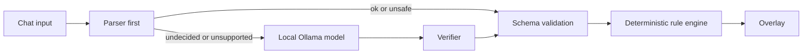

# Beast Rules

Beast Rules is a Twitch overlay where chat writes the rules of the stream and the rules are the creature. A viewer types `!law when someone subs grow wings`. Chat votes. If it passes, the beast grows wings on screen, and from then on the law fires on real Twitch events.

Each law in force takes one part of the beast's body. When two laws want the same part, chat votes on which one survives, and the loser leaves a scar. The beast is a state machine you can see: its body is the list of laws, and its scars are the laws that lost.

I built it alone for the Codex x TwitchCon Hackathon. Codex wrote most of the code. When its free credits ran out I finished the last features with another AI assistant, and the [build log](docs/CODEX_LOG.md) says which step is which.


## Try it in 60 seconds

```sh
npm install && npm run sandbox
```

Open [localhost:3000/sandbox.html](http://localhost:3000/sandbox.html) to play with simulated viewers. The transparent overlay for OBS is at [localhost:3000/overlay.html](http://localhost:3000/overlay.html). No Twitch credentials are needed, and Ollama is optional.

If you would rather watch than click, this plays the whole story by itself (a law, a crisis, a repeal, a naming vote, the constitution):

```sh
npm run demo
```

To use it on a real stream, add the overlay URL to OBS as a browser source and follow the Twitch setup below.

## How it differs from other stream tools

- Node-editor automation tools ask the streamer to build the logic alone, in a graph most viewers cannot read. Here a viewer writes the logic as one sentence, and the result is a picture.
- Chat pets give viewers something to feed. This creature has no stats. Its body is the list of laws.
- Overlays that let chat prompt an AI show whatever text comes back. Here no model text reaches the screen. A proposal becomes a rule from a closed list, or the beast refuses it.
- Reward menus offer choices the streamer prepared. Here chat invents the choice, votes on it, and can repeal it later.

These are categories, not specific products.

## Safety

Nothing a viewer types is shown on screen. A proposal is compiled into a rule built from fixed lists of triggers, actions, parts and colors, and the overlay shows a description assembled from those validated values. The original sentence stays in server logs and saved history only. Refusals are fixed messages in the beast's voice, and usernames are stripped of control characters, cut to 24 characters and drawn as plain text.



The deterministic parser handles every sentence it understands. If you run a local model, it only gets the sentences the parser could not decide, it can only return values from the schema, and its answer has to pass a verifier and then the schema before the rule engine sees it.

## An example law

Chat sends:

```text
when someone subs grow wings and shake the screen
```

The real parser produces this rule, which passes the schema:

```json
{
  "status": "ok",
  "trigger": {
    "event_type": "channel.subscribe",
    "threshold": 1
  },
  "action": {
    "type": "screen_shake",
    "intensity": "low"
  },
  "mutation": {
    "part_id": "wings",
    "color": "yellow"
  }
}
```

When the vote passes, the overlay shows a banner and the wings grow. After that, each subscription triggers the screen shake.

## How accurate is the compiler

I measured it on sets of 30 sentences.

| Set | Parser alone | With local-model rescue | Note |
| --- | ---: | ---: | --- |
| Contract (`tests/laws.json`, 28 cases) | 28/28 | n/a | Written alongside the parser, so it is a regression suite and not a test of generalization. |
| Held-out set 1 | 18/30 | 24/30, later 25/30 | Became a development set once its failures were fixed. |
| Held-out set 2, first two runs | 23/30 (76.7%) | 24/30 and 25/30 | Its failures were fixed afterwards, so the parser now scores 28/30 on it. That number no longer measures anything independent. |
| Held-out set 3 (`tests/heldout3.json`) | 25/30 (83.3%) | 26/30 (86.7%) | 30 new phrasings, written after the last parser change, run once and never tuned against. Paths taken: parser 26, model (verified) 1, parser (model rejected) 3. |

The four misses on set 3 have one thing in common. When a sentence names an effect or a part the beast does not know ("moonwalk", "jetpack"), or is vague or destructive ("do something cool on subs", "delete the chat history"), the parser can fall back to a harmless default rule instead of refusing. That is safe, because the closed vocabulary cannot do anything harmful, but it gives the viewer the wrong feedback. I left it unfixed so the set stays an honest measurement.

To reproduce the numbers, run `npm run eval -- --file tests/heldout3.json --verbose`. The model's rescue results vary between runs, and sets this small only measure their own phrasings.

<details>
<summary>All 28 contract cases, as the real parser handles them today</summary>

| Sentence | What the compiler produced | Pass |
|---|---|---|
| when someone subs grow wings and shake the screen | subscribe → yellow wings, screen_shake | ✅ |
| every follow gives the beast horns | follow → yellow horns, confetti | ✅ |
| on a raid make the beast roar and grow flames | raid → yellow flames, beast_roar | ✅ |
| when someone cheers bits give it purple lightning | cheer → purple lightning, confetti | ✅ |
| if chat hits 30 messages a minute flash the screen and grow spikes | chat.message ×30 → yellow spikes, screen_flash | ✅ |
| gift subs make the beast grow a golden crown | subscription.gift → yellow crown, confetti | ✅ |
| when a hype train starts throw confetti and grow extra arms | hype_train.begin → yellow extra arms, confetti | ✅ |
| every 5 subs switch to scene 2 and grow armor | subscribe ×5 → yellow armor, obs_scene_2 | ✅ |
| when chat gets loud trigger dare 1 | chat.message → yellow runes, dare_1 | ✅ |
| follows make the beast grow red eyes | follow → red eyes, confetti | ✅ |
| 10 cheers gives it blue tentacles and a screen shake | cheer ×10 → blue tentacles, screen_shake | ✅ |
| raids give the beast a green shell | raid → green shell, confetti | ✅ |
| when someone subs give it a long pink tail | subscribe → pink tail, confetti | ✅ |
| chat spamming 50 messages a minute triggers dare 3 and claws | chat.message ×50 → yellow claws, dare_3 | ✅ |
| subs summon lightning and the beast roars | subscribe → yellow lightning, beast_roar | ✅ |
| new followers make it grow scales and flash orange | follow → orange scales, screen_flash | ✅ |
| when someone donates ten dollars grow wings | refused: unsupported_trigger | ✅ |
| when the streamer dies in the game grow horns | refused: unsupported_trigger | ✅ |
| make the beast dance when someone subs | refused: unsupported_effect | ✅ |
| grow a laser cannon when someone subs | refused: unsupported_part | ✅ |
| switch to scene 7 on a raid | refused: unsupported_effect | ✅ |
| make it cooler | refused: too_vague | ✅ |
| something with the beast | refused: too_vague | ✅ |
| do stuff | refused: too_vague | ✅ |
| ban the loudest chatter whenever chat is busy | refused: unsafe | ✅ |
| when someone subs show the streamer's home address | refused: unsafe | ✅ |
| grow horns and tell chat to harass the mod | refused: unsafe | ✅ |
| timeout everyone who follows | refused: unsafe | ✅ |

</details>

## What it does

Laws and votes:
- Viewers propose laws with `!law` and vote with `yes` or `no`. One vote runs at a time, each viewer has a cooldown, and the streamer can pause, resume, veto or reset.
- Each body zone holds one law. A law in an occupied zone triggers a crisis vote between the old law and the new one. A short silence before the verdict gives the vote some weight, and the loser leaves a crack on the beast.
- `!repeal 3` opens a vote to remove `law-3`, which also leaves a scar.
- Every few minutes (`BALLOT_MINUTES`, default 5, `0` turns it off) the overlay offers three suggested laws, and chat types `1`, `2` or `3`. The suggestions are built from templates, run through the real parser, and favor empty body zones and recent events.

The creature:
- A transparent SVG beast with 15 parts, five evolution tiers and a live vote ticker.
- Chat names it once through a vote among a fixed list (`!name`). Viewer text can never become the name.
- It shows a temperament computed from its laws and history, a visible desire ("Pebble wants a law about raids") and a mood that drives its idle animation.
- Law banners lead with what happened ("The beast grew yellow wings. passed 3-1. written by viewer_2"), and the law's sponsor gets a shout when it fires.
- Refusals speak in the beast's voice, and `!tongue` lists its whole vocabulary.

Twitch:
- EventSub over WebSocket for chat, follows, subscriptions, gift subscriptions, cheers, raids and hype trains. `/health` reports the state of each subscription.
- OBS scene actions mapped to scene names you set. This is tested with mocks only. I have not tried live OBS switching.
- Synthesized sound cues, with no audio files.

Documents you can share:
- `!constitution` lists the active laws on the overlay. `/constitution.html` is a printable constitution with a cover (the beast's name, temperament, ratification date and an integrity score) and every law ever written, with its title, proposer, date and status.
- `/recap.html` is a 1200x630 card with the beast's portrait, its laws and its top lawmakers. `npm run recap` saves it as a PNG for Discord (it needs Chrome, Chromium or Edge).

## How Codex built this

I built this in one Codex thread, from a written spec: `AGENTS.md`, a JSON schema and contract tests. The spec and the step-by-step prompts were drafted with help from another AI assistant. I chose what to build, ran every step in Codex, and decided what stayed. Each step ended with tests, a build and a lint, and the suite now has 268 tests in 20 files. The [build log](docs/CODEX_LOG.md) records each step, including the failures.

Codex built the compiler, the rule engine, the overlay, the crisis votes, the sounds, the safety layer, the toasts, the hints and the fixed refusal messages. Its free credits ran out after the rename to Beast Rules. After that I finished the work with another AI assistant: the network-resilience fix, the ballot and repeal, the chat-command parser, the beast's character and the constitution, the recap card, and the recording scripts. Those log entries are labelled "written with another AI assistant, not Codex."

Three things Codex got wrong, and what caught them:

1. The first parser emitted `eventType` where the schema requires `event_type`. The first contract run failed 22 cases. The parser was fixed and the schema stayed the source of truth ([log entry](docs/CODEX_LOG.md#roadmap-step-2--templatecompiler-only)).
2. The check that a model's rule agrees with the viewer's words treated "scene" as a fuzzy match for the color "green". The tests caught it before I ran the evaluation set, and the fuzzy match now requires the same prefix ([log entry](docs/CODEX_LOG.md#parser-numbercolor-support-effect-verification-and-heldout2-evaluation)).
3. A real `gemma3:4b` call took 6.5 seconds, longer than the five-second timeout, and the held-out runs showed the model alone was less reliable than I had hoped. The design changed to parser first, with the model allowed to rescue only the sentences the parser refuses, behind a verifier ([log entry](docs/CODEX_LOG.md#ollama-compiler-and-automatic-fallback)).

No model call at runtime goes through Codex. Laws are compiled by the local parser and, if you run one, a local Ollama model.

## Twitch setup and live test

1. Create a Twitch developer app. The category does not matter. Set the redirect URL to `http://localhost:3001/auth/callback`.
2. Put the client ID and secret in `.env` as `TWITCH_CLIENT_ID` and `TWITCH_CLIENT_SECRET`, and set `TWITCH_REDIRECT_URI=http://localhost:3001/auth/callback`.
3. Run `npm run twitch:auth` and authorize as the broadcaster. The token is saved in `data/twitch-token.json`, which git ignores.
4. Start the server with `npm run sandbox` and open `http://localhost:3000/health`. Twitch should show as connected, with the EventSub subscriptions active.
5. In the broadcaster's chat, send `!law when someone follows grow blue horns`, then vote `yes`. The broadcaster's own messages are processed, so one account can test proposals and votes.
6. From a second account, follow the channel and watch for the matching law to fire. A broadcaster cannot follow their own channel.

The broadcaster needs these scopes: `user:read:chat`, `moderator:read:followers`, `channel:read:subscriptions`, `bits:read` and `channel:read:hype_train`. Raids need no scope. `user:write:chat` is only needed with `CHAT_REPLIES=on`, which is off by default.

For local EventSub mocks, run `twitch event websocket start-server --port 8080`, set `TWURPLE_MOCK_API_PORT=8080` (or `TWITCH_EVENTSUB_WS_URL`), then trigger events with `twitch event trigger channel.follow -T websocket --session SESSION_ID -u BROADCASTER_ID`. The payload options vary with the Twitch CLI version.

### Recording helpers

These scripts exist so I could record clean footage. They only call the same endpoints the sandbox uses.

| Command | What it does |
| --- | --- |
| `npm run live` | Starts the server for a recording with real chat: 15-second votes, a separate `data-live` folder so your real beast is untouched, and scheduled ballots off (an open ballot blocks new `!law` proposals). |
| `npm run live:guide` | Prints in the terminal what to type at each moment (a vote opens, a law passes, a crisis opens). It only reads. |
| `npm run ballot` | Opens a ballot on demand on the live server. |
| `npm run demo:auto` | Like `npm run demo`, but starts by itself after 20 seconds. |
| `npm run refusals`, `npm run crisis:setup` then `npm run crisis`, `npm run ballot:scene`, `npm run repeal:scene`, `npm run panel` | Play one scene of the demo on a running sandbox server so it can be recorded on its own. |

Add `?bg=dark` to the overlay URL to paint a dark backdrop when you record it in a normal browser tab. OBS keeps it transparent without that.

### OBS scene setup

In OBS, turn on the WebSocket server under Tools, WebSocket Server Settings, and set a password. Set `OBS_WS_URL`, `OBS_WS_PASSWORD` and the exact scene names in `OBS_SCENE_1`, `OBS_SCENE_2` and `OBS_SCENE_3`. `SCENE_RETURN_SECONDS` defaults to 6. Chat can pick only the three numbered actions, never a scene name. OBS switching is tested with mocks only.

## Resilience

A network hiccup must not take the overlay down mid-stream. While I was testing live, a keepalive timeout on the Twitch WebSocket crashed the whole server: the `ws` library emitted an `error` event on a socket that was still reconnecting, and nothing was listening.

- Process guards catch `uncaughtException` and `unhandledRejection` when the error comes from the Twitch, OBS or WebSocket layer, or is a plain network error, and log it. An error thrown from this project's own code still exits with a non-zero code, so real bugs are not hidden.
- Twurple retries by itself. If Twitch is still disconnected after 5, 10, 20 and then every 30 seconds, a supervisor stops the listener and starts it again. A failed first start, such as no network at launch, is retried the same way.
- `/health` reports `twitchConnected`, `twitchReconnecting`, `lastDisconnectAt` and `reconnectAttempts`. The sandbox shows "Twitch: reconnecting", and the overlay shows a small dot (add `?obs=1` to hide it in OBS).
- The overlay and sandbox keep working from saved state while Twitch is down.

This is covered by 14 unit tests, including the exact error shape from the crash. I also froze the server process for 40 seconds to mimic a laptop going to sleep. It stayed up, logged the disconnect, reconnected on its own, and `/health` showed all seven subscriptions active again.

## Known limitations

- The law language is narrow. Unsupported or ambiguous phrasing may be refused or safely defaulted, as the held-out scores show.
- Ollama has to be running locally for model rescue, and its results vary. Without it, the parser handles everything it understands.
- Twitch needs a developer app, broadcaster authorization and the scopes above. Testing a follow needs a second account.
- OBS scene actions need a reachable OBS WebSocket server and mapped scene names. Only the mocks have been tested.
- I have tried `!law`, votes, `!laws`, `!name`, the crisis vote, the ballot and a real follow from a second account in real Twitch chat. `!repeal` and the `!beast` controls are covered by tests, and I have not tried them live.
- The sound cues are synthesized in the browser. Tests check that they build and stay under two seconds, but I have not had a proper listening session.
