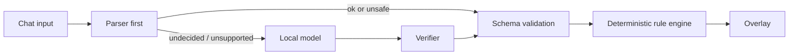

# Constitution Beast

Chat writes the laws of the stream, and the laws are the creature. Viewers propose rules, vote on them, and watch those rules shape a shared animated beast.

## Try it in 60 seconds

```sh
npm install && npm run sandbox
```

No Twitch credentials are needed for the local sandbox. Open [http://localhost:3000/sandbox.html](http://localhost:3000/sandbox.html); use [http://localhost:3000/overlay.html](http://localhost:3000/overlay.html) as the transparent OBS browser source. Ollama is optional; when it is unavailable, the parser handles eligible proposals.

## Safety gate



The model can only emit values from the rule schema; verified results are schema-validated before reaching the deterministic engine.

## What works today

- Template compiler maps supported triggers, effects, beast parts, colors, and thresholds into schema-validated rules.
- Optional local Ollama compiler can rescue parser refusals; verified trigger, part, color, and effect checks reject inconsistent outputs.
- Passed laws update persistent state, replace parts by zone through a constitutional crisis vote, and keep an overruled-law history.
- The overlay renders the beast, live vote/crisis state, law-passed banners, part pulses, and the supported screen effects.
- The sandbox simulates five viewers and follow, sub, raid, cheer, and chat-spike events without Twitch credentials.
- Twurple EventSub WebSocket integration and chat command translation are implemented and covered by fixture tests; `/health` reports connection and subscription status.

## Measured compile accuracy

The TemplateCompiler passes **28/28** contract cases in `tests/laws.json`. The eval compares only fields present in each case's expected result.

`tests/heldout.json` became a development set after parser fixes. Its logged initial run was parser **18/30 (60.0%)**, AutoCompiler **24/30 (80.0%)**. A later verbose run recorded parser **18/30 (60.0%)**, AutoCompiler **25/30 (83.3%)**.

The separate `tests/heldout2.json` evaluation was run twice without tuning between runs:

- **Run 1:** TemplateCompiler **23/30 (76.7%)**; AutoCompiler **24/30 (80.0%)**.
- **Run 2:** TemplateCompiler **23/30 (76.7%)**; AutoCompiler **25/30 (83.3%)**.

AutoCompiler's result varied because local model rescue can differ between runs. These small sets measure only their included phrasings, not general language understanding.

## How Codex built this

The implementation history and check results are in [docs/CODEX_LOG.md](docs/CODEX_LOG.md). Codex helped build the project; runtime law compilation uses the local parser and optional local Ollama model, not Codex.

## Twitch setup

### Create and authorize the Twitch app

1. Create an app in the [Twitch Developer Console](https://dev.twitch.tv/console/apps). Choose **Confidential** and **Chat Bot**.
2. Set its redirect URL to `http://localhost:3001/auth/callback`.
3. Put the client ID and client secret in `.env` as `TWITCH_CLIENT_ID` and `TWITCH_CLIENT_SECRET`; set `TWITCH_REDIRECT_URI=http://localhost:3001/auth/callback`.
4. Run `npm run twitch:auth` and authorize while logged in as the broadcaster. The refreshable token is stored in ignored `data/twitch-token.json`.
5. Start the app with `npm run sandbox`. Set `TWITCH_BROADCASTER_ID` only to override the ID inferred from the authorized token.

Required broadcaster scopes:

- `user:read:chat` — chat messages and chatter identity.
- `moderator:read:followers` — channel follow v2.
- `channel:read:subscriptions` — subscriptions and gifted subscriptions.
- `bits:read` — cheers.
- `channel:read:hype_train` — hype train begin v2.
- Raids require no OAuth scope.
- `user:write:chat` is optional and only needed when `CHAT_REPLIES=on`.

### Test live on Twitch

1. Start the server with `npm run sandbox` and keep the terminal open for EventSub and decision logs.
2. Open `http://localhost:3000/health`. Check `twitchConnected`, the broadcaster ID, and that the expected subscription statuses are `active`.
3. From the broadcaster account's own chat, type `!law when someone follows grow blue horns`. Broadcaster-authored chat messages are processed, so one account can submit a law and vote.
4. Type `yes` or `1` in chat to vote. Check the overlay banner and terminal decision logs after the vote passes.
5. From a second account, follow the channel and confirm the follow notification and law effect. The broadcaster cannot follow their own channel.

Troubleshooting:

| Symptom | Check |
| --- | --- |
| Redirect mismatch | The Twitch app redirect and `TWITCH_REDIRECT_URI` must both exactly match `http://localhost:3001/auth/callback`; then rerun `npm run twitch:auth`. |
| Missing scope | Add the listed scope to the app authorization and rerun `npm run twitch:auth` to replace the saved token. |
| Token expired | Reauthorize with `npm run twitch:auth` while logged in as the broadcaster. |
| Subscription failed | Inspect `/health` statuses and terminal messages; verify broadcaster ID, token account, and required scopes. |

### Twitch CLI mock events

For local EventSub mocks, install the [Twitch CLI](https://dev.twitch.tv/docs/cli/) and run:

```sh
twitch event websocket start-server --port 8080
```

Set `TWURPLE_MOCK_API_PORT=8080` for the app (or set `TWITCH_EVENTSUB_WS_URL` to another mock WebSocket URL). Start `npm run sandbox` in another terminal and use the current session ID shown by the app:

```sh
twitch event trigger channel.follow -T websocket --session SESSION_ID -u BROADCASTER_ID
twitch event trigger channel.chat.message -T websocket --session SESSION_ID -u BROADCASTER_ID
```

Other registered event types include `channel.subscribe`, `channel.subscription.gift`, `channel.cheer`, `channel.raid`, and `channel.hype_train.begin`. CLI payload options vary by CLI version; check `twitch event trigger --help`.

## Known limitations

- The rule language is intentionally narrow. Unsupported or ambiguous wording may be refused or parsed as a safe default; the held-out scores above show this limitation.
- Ollama must be installed and running locally for model rescue. A timed-out or unverifiable response falls back to the parser result.
- The live Twitch setup requires a developer app, broadcaster authorization, and the listed scopes. Follow tests require a second account.
- The `demo` npm script is a placeholder; a scripted demo replay is not implemented.
