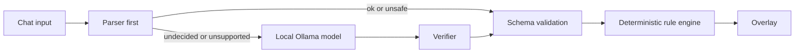

# Beast Rules

Chat writes the laws of the stream, and the laws are the creature. Viewers propose rules, vote on them, and watch the beast evolve.

**Screenshot placeholder:** `docs/images/banner.png`<br>
**Law-pass GIF placeholder:** `docs/images/law-pass.gif`<br>
Demo video: [link coming]<br>
Devpost: [link coming]

## Try it in 60 seconds

```sh
npm install && npm run sandbox
```

No credentials are needed. Open [localhost:3000/sandbox.html](http://localhost:3000/sandbox.html); the transparent OBS browser source is [localhost:3000/overlay.html](http://localhost:3000/overlay.html). Ollama is optional.

## Safety gate

Viewer proposals are compiled into closed-schema rules. The original chat sentence is kept for server-side logs and persisted history only; the overlay and sandbox receive a canonical description assembled from validated trigger, action, part, and color enums. Refusal and error messages shown to viewers are fixed text, and displayed usernames are control-character-stripped, capped at 24 characters, and rendered as text.



The model can only emit values from the schema; verified model results pass schema validation before the deterministic engine handles them.

## Example law

Chat sends:

```text
when someone subs grow wings and shake the screen
```

The real TemplateCompiler produces this schema-valid rule:

```json
{
  "status": "ok",
  "trigger": {
    "event_type": "channel.subscribe",
    "threshold": 1
  },
  "action": {
    "type": "screen_shake",
    "intensity": "low"
  },
  "mutation": {
    "part_id": "wings",
    "color": "yellow"
  }
}
```

When the vote passes, the overlay shows the law-passed banner and pulses the wings; a subscription then triggers the screen shake.

## What works today

- Schema-validated template parsing, with 28/28 contract cases passing; optional local Ollama rescue uses a verifier and falls back safely.
- Persistent proposals, voting, zone replacement, constitutional crisis votes, streamer pause/resume/reset/veto controls, and overlay snapshots.
- Transparent SVG beast overlay with five evolution tiers, all 15 parts, law-passed and crisis-resolution banners, proposer credits, and a live vote ticker.
- Synthesized Web Audio cues (no audio files), plus sandbox crowd simulation with adjustable yes bias and direct buttons for the four overlay effects.
- Twitch EventSub WebSocket integration for chat, follow, subscription, gift, cheer, raid, and hype-train events; chat command translation and fixtures are tested. `/health` reports service state.
- OBS scene actions mapped to server-configured scene names; the adapter is tested with mocks only. Live OBS switching has not been verified.

## Measured compile accuracy

| Set | Parser | AutoCompiler |
| --- | ---: | ---: |
| Contract (`tests/laws.json`) | 28/28 | — |
| Heldout development set | 18/30 | 24/30, later 25/30 |
| Heldout2 run 1 | 23/30 | 24/30 |
| Heldout2 run 2 | 23/30 | 25/30 |

These small, fixed sets are not a measure of general language understanding, and Ollama results can vary between runs.

## How Codex built this

This project was built in one Codex thread from a written spec: `AGENTS.md`, the JSON schema, and contract tests guided the implementation. Each roadmap step ended with tests, build, and lint; the current suite has **189 tests across 13 files**. The detailed history is in [docs/CODEX_LOG.md](docs/CODEX_LOG.md).

Three examples of problems found and resolved: [the parser initially emitted `eventType` instead of schema-required `event_type`](docs/CODEX_LOG.md#roadmap-step-2--templatecompiler-only); [npm's shared cache rejected writes, so installation was retried with a temporary cache](docs/CODEX_LOG.md#streamer-controls-and-obs-scene-switching); and [the preview initially missed its first frame, so it was rerun from the start and all 15 parts were verified](docs/CODEX_LOG.md#sandbox-crowd-bias-reliable-part-preview-and-legacy-proposer-labels). **No runtime model call goes through Codex:** law compilation uses the local parser and, when configured, a local Ollama server.

## Twitch setup and live test

1. Create a Twitch developer app. The app category does not matter; selecting “Chat Bot” is not required. Set the redirect URL to `http://localhost:3001/auth/callback`.
2. Put the client ID and secret in `.env` as `TWITCH_CLIENT_ID` and `TWITCH_CLIENT_SECRET`; set `TWITCH_REDIRECT_URI=http://localhost:3001/auth/callback`.
3. Run `npm run twitch:auth` and authorize as the broadcaster. The token is stored in ignored `data/twitch-token.json`.
4. Start the server with `npm run sandbox` and check `http://localhost:3000/health`. Confirm Twitch is connected and EventSub subscriptions are active.
5. In the broadcaster's chat, send `!law when someone follows grow blue horns`, then vote `yes`. Broadcaster-authored chat is processed, so one account can test proposal and vote commands.
6. From a second account, follow the channel and confirm the EventSub notification and matching law effect. A broadcaster cannot follow their own channel.

Required broadcaster scopes: `user:read:chat`, `moderator:read:followers`, `channel:read:subscriptions`, `bits:read`, and `channel:read:hype_train`. Raids require no OAuth scope. `user:write:chat` is optional and only needed with `CHAT_REPLIES=on`.

For local EventSub mocks, run `twitch event websocket start-server --port 8080`, set `TWURPLE_MOCK_API_PORT=8080` (or `TWITCH_EVENTSUB_WS_URL`), then trigger events with `twitch event trigger channel.follow -T websocket --session SESSION_ID -u BROADCASTER_ID`. The Twitch CLI's available payload options vary by version.

### OBS scene setup

In OBS, enable the WebSocket server in **Tools → WebSocket Server Settings** and set a password. Configure `OBS_WS_URL`, `OBS_WS_PASSWORD`, and exact scene names in `OBS_SCENE_1`, `OBS_SCENE_2`, and `OBS_SCENE_3`; `SCENE_RETURN_SECONDS` defaults to 6. Chat can choose only the three numbered actions, never a scene name. OBS switching is mock-tested, not live-verified.

## Known limitations

- The law language is narrow; unsupported or ambiguous phrasing may be refused or safely defaulted. The held-out scores above show its limits.
- Ollama must be running locally for model rescue, and rescue results vary. Ollama is optional; the parser remains available without it.
- Twitch requires a developer app, broadcaster authorization, and the listed scopes. Follow testing needs another account.
- OBS scene actions require a configured, reachable OBS WebSocket server and mapped scene names; only mock behavior has been verified.
- Screenshot, GIF, demo-video, and Devpost links above are placeholders, not implemented artifacts.
